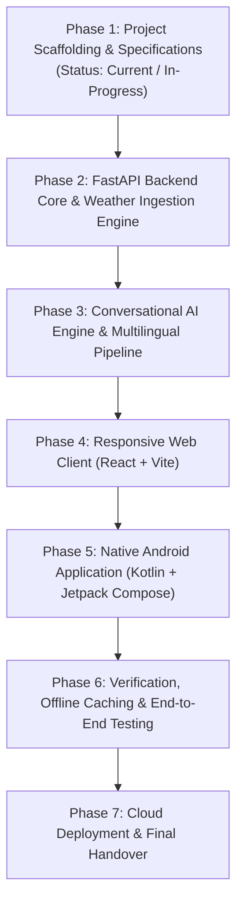

# Development Roadmap: WeatherGPT

**SIH Problem Statement ID**: SIH26068  
**Project Title**: WeatherGPT: AI-Powered Multilingual Weather Forecasting and Alert Assistant  

---

## Phased Implementation Plan

This project strictly adheres to an incremental, phased software engineering approach. Each phase must be verified and tested before progressing to subsequent stages.

---

## Phase 1: Project Scaffolding & Architecture Specifications
**Focus**: Project directory setup, documentation, configuration templates, and foundational architecture.

### Milestones & Deliverables:
- [x] Create standardized repository structure (`website/`, `android/`, `backend/`, `shared/`, `docs/`, `deployment/`).
- [x] Define root configuration files (`README.md`, `.gitignore`, `.env.example`).
- [x] Author comprehensive architecture, requirements, and project overview documentation.
- [x] Establish Git tracking guidelines and `.gitkeep` markers for empty directories.

### Verification Criteria:
- Directory tree adheres to specification.
- No sensitive keys or unvetted scripts committed.
- Documentation accurately reflects SIH26068 problem requirements.

---

## Phase 2: FastAPI Backend Core & Meteorological Engine
**Focus**: Python backend, data models, weather ingestion adapters, geocoding, and caching.

### Milestones & Deliverables:
- [ ] Initialize Python virtual environment, dependencies (`fastapi`, `uvicorn`, `httpx`, `pydantic`, `sqlalchemy`).
- [ ] Implement modular weather service adapter (Open-Meteo primary, extensible to WeatherAPI/OpenWeatherMap).
- [ ] Build location geocoding and search endpoints.
- [ ] Implement SQLite-backed and in-memory TTL caching layer for weather responses.
- [ ] Build severe weather alert parser and normalization engine.
- [ ] Implement agricultural rule engine (irrigation, spraying window) and travel advisory rule engine.

### Verification Criteria:
- Automated pytest suite verifies weather ingestion with real API responses.
- Cache correctly prevents duplicate network requests within the TTL period.
- Health check and documentation endpoints (`/docs`, `/redoc`) function cleanly.

---

## Phase 3: Conversational AI Engine & Multilingual Assistant
**Focus**: Context grounding, LLM orchestration, multilingual prompt engineering, and guardrails.

### Milestones & Deliverables:
- [ ] Build LLM client wrapper (Gemini / OpenAI) with fallback and retry mechanisms.
- [ ] Design trilingual system prompts (English, Hindi, Marathi) with strict weather context injection.
- [ ] Implement guardrails preventing speculation, forecast hallucination, or unverified disaster claims.
- [ ] Integrate domain advisories (AgriGPT & TravelGPT) into conversational context.
- [ ] Build `/api/v1/assistant/chat` endpoint with input sanitization and language detection.

### Verification Criteria:
- Automated evaluation tests verifying answers are grounded strictly in supplied weather JSON.
- Accurate trilingual prompt-response testing across English, Hindi, and Marathi.
- Latency and token usage measurements within acceptable thresholds.

---

## Phase 4: Responsive Web Frontend (React + Vite)
**Focus**: Interactive web client, real-time weather visualizer, voice interface, and i18n.

### Milestones & Deliverables:
- [ ] Initialize React + Vite project with Tailwind CSS.
- [ ] Implement weather dashboard (current conditions, hourly scrubber, 7-day forecast cards).
- [ ] Implement location search with auto-suggest and geolocation support.
- [ ] Build interactive WeatherGPT chat drawer/widget with conversation history.
- [ ] Integrate Web Speech API for voice queries and Text-to-Speech audio output.
- [ ] Build UI language switcher (`en`, `hi`, `mr`) with reactive UI string updates.
- [ ] Add client-side caching (localStorage / IndexedDB) for offline viewing.

### Verification Criteria:
- Responsive layout verified on mobile (360px), tablet (768px), and desktop (1280px+).
- Speech-to-text and text-to-speech tested in supported browsers.
- Real backend API integration tested with live forecast rendering.

---

## Phase 5: Native Android Application (Kotlin + Jetpack Compose)
**Focus**: High-performance native mobile experience, native voice engine, and local Room DB.

### Milestones & Deliverables:
- [ ] Scaffold native Android project with Gradle Kotlin DSL and Jetpack Compose.
- [ ] Build Material 3 UI: weather dashboard, hourly cards, multi-day forecast, and alert banners.
- [ ] Implement Retrofit client communicating with the shared FastAPI backend.
- [ ] Build native conversational chat screen with voice input (`SpeechRecognizer`) and TTS (`TextToSpeech`).
- [ ] Implement offline caching with Android Room Database.
- [ ] Support runtime language selection (English, Hindi, Marathi) matching the backend catalog.

### Verification Criteria:
- Android build compiles cleanly via Gradle.
- Native voice recognition successfully records and transcribes Hindi, Marathi, and English.
- App displays cached forecasts when operating in airplane mode.

---

## Phase 6: System Integration, Security & End-to-End Verification
**Focus**: Cross-platform verification, load testing, edge-case validation, and security audit.

### Milestones & Deliverables:
- [ ] End-to-end integration tests between Web, Android, and Backend.
- [ ] Verify CORS, rate limiting, and error handling for invalid coordinates/queries.
- [ ] Verify security: Ensure no secrets are leaked in client bundles or network traces.
- [ ] Accessibility review (WCAG compliance for web, TalkBack support for Android).

### Verification Criteria:
- All integration and unit tests passing with zero critical vulnerabilities.
- Verified parity between website and Android outputs for identical queries.

---

## Phase 7: Deployment & Production Readiness
**Focus**: Cloud deployment, production environment variables, and user documentation.

### Milestones & Deliverables:
- [ ] Deploy React website to Vercel with production build optimizations.
- [ ] Deploy FastAPI backend to cloud host with production ASGI server.
- [ ] Configure custom domain, SSL certificates, and environment secrets.
- [ ] Package Android release APK / AAB.
- [ ] Finalize user manuals, demo videos, and hackathon presentation collateral.

### Verification Criteria:
- Live production URLs active and serving HTTPS traffic.
- Zero CORS errors between production website and production backend.
