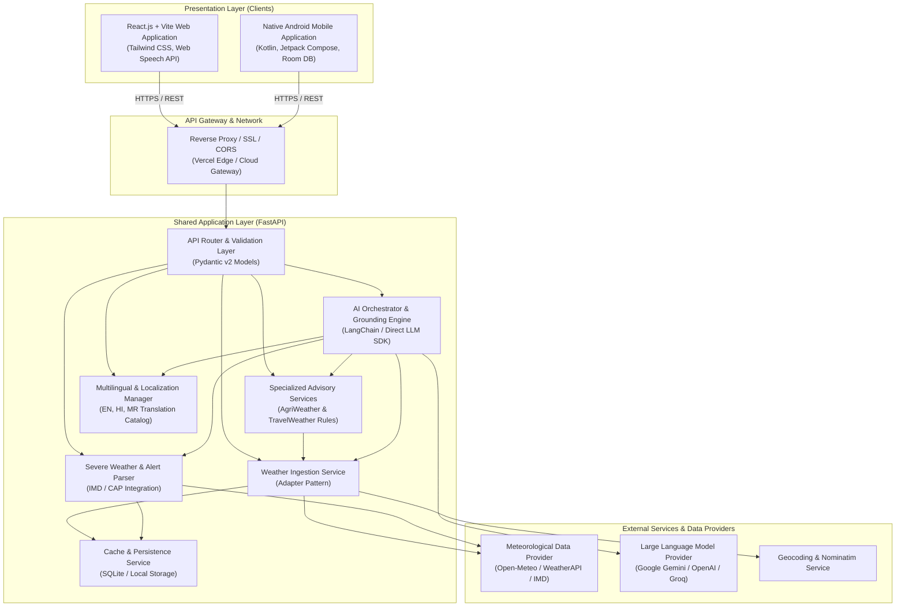

# System Architecture: WeatherGPT

**SIH Problem Statement ID**: SIH26068  
**Document Status**: Architectural Specification  

---

## 1. High-Level Architecture Diagram



---

## 2. Core Architectural Subsystems

### 2.1 Presentation Layer

#### A. Responsive Web Application (`/website`)
- **Framework**: React 18 with Vite build tooling for fast HMR and optimized asset bundling.
- **Styling**: Tailwind CSS for responsive mobile-first UI components.
- **State Management & Data Fetching**: React hooks and TanStack Query (or lightweight custom fetchers) with local cache fallback in `localStorage` or `IndexedDB`.
- **Speech Engine**: Web Speech API (`SpeechRecognition` for audio input; `speechSynthesis` for text-to-speech output).
- **Internationalization (i18n)**: Dedicated trilingual catalog (`en`, `hi`, `mr`) for instant client-side UI switching.

#### B. Native Android Application (`/android`)
- **Language & UI**: 100% Kotlin utilizing Jetpack Compose and Material 3 design system.
- **Networking**: Retrofit 2 + OkHttp with logging interceptors, timeout controls, and JSON serialization (Kotlinx.serialization or Moshi).
- **Offline Storage**: Room Database for caching forecast data and past conversational sessions.
- **Speech Processing**: Native Android `SpeechRecognizer` with language locale configuration (`en-IN`, `hi-IN`, `mr-IN`) and Android `TextToSpeech` engine.
- **Architecture**: Clean MVVM (Model-View-ViewModel) pattern with StateFlow and Coroutines for asynchronous reactive updates.

---

### 2.2 Shared Application Layer (`/backend`)

The backend is built with **FastAPI** to maximize execution speed, maintain asynchronous non-blocking I/O, and automatically generate comprehensive OpenAPI documentation.

#### Key Modules:
1. **API Router & Validation**: Enforces strict schemas using Pydantic v2. Prevents malformed requests and validates latitude/longitude boundaries.
2. **Weather Adapter Service**: Implements the Adapter Pattern to decouple the core app from any single weather provider. Defaults to Open-Meteo for rich meteorological parameters without requiring mandatory API keys during testing, while allowing configuration of alternative APIs (e.g., OpenWeatherMap, IMD).
3. **AI Grounding & Prompt Orchestration Engine**:
   - Collects live weather payload + active alerts.
   - Embeds context into structured system prompts.
   - Enforces trilingual synthesis (Hindi, Marathi, English) with culturally relevant colloquial vocabulary.
   - Mandates strict adherence to provided metrics (zero-hallucination policy).
4. **Advisory Logic Engines**:
   - `AgriWeatherEngine`: Analyzes precipitation probabilities, temperature thresholds (heat stress, frost), and humidity for agricultural guidance.
   - `TravelWeatherEngine`: Scans for dense fog, thunderstorm warnings, extreme winds, and recommends appropriate precautions.
5. **Caching & Persistence Layer**:
   - Built on SQLite initially via SQLAlchemy / aiosqlite for zero-configuration, cross-platform persistence.
   - In-memory time-to-live (TTL) cache to serve identical coordinate queries within 15 minutes without hitting external API limits.

---

## 3. Grounded AI & Conversational Flow

```
User Query (Text/Voice)
  │
  ▼
[Input Parser & Language Detection] (EN / HI / MR)
  │
  ▼
[Location Resolver / Geocoder] (Resolve City / Tehsil to Lat, Lon)
  │
  ▼
[Weather Fetcher & Cache Check] ── Cache Hit? ──► Return Cached JSON
  │ (No)
  ▼
[Call External Weather Provider] ──► Parse & Cache Response (TTL 15m)
  │
  ▼
[Advisory Engine Enrichment] (Compute Rain, Spraying, Travel Indicators)
  │
  ▼
[Assemble Strict Grounded Context]
  ├── Current Weather Metrics
  ├── Hourly & 7-Day Forecast Summary
  ├── Official Warnings & Severe Alerts
  └── Target Language & Cultural Directives
  │
  ▼
[Call LLM (Gemini / OpenAI)] ── Prompt: "Answer ONLY based on the facts below"
  │
  ▼
[Verify & Sanitize AI Output]
  │
  ▼
Return Structured JSON Response (Text Answer + Raw Weather Payload + Audio Metadata)
```

---

## 4. API Endpoints Specification (REST)

| Method | Endpoint | Description |
|---|---|---|
| `GET` | `/api/v1/health` | Service health status and uptime |
| `GET` | `/api/v1/weather/current` | Real-time weather for `lat`, `lon` or `location` query |
| `GET` | `/api/v1/weather/hourly` | 24-48 hour hourly forecast data |
| `GET` | `/api/v1/weather/daily` | 7-14 day extended daily forecast |
| `GET` | `/api/v1/weather/alerts` | Active severe weather alerts and advisories |
| `GET` | `/api/v1/locations/search` | Search locations by name (with multilingual support) |
| `POST` | `/api/v1/assistant/chat` | Conversational query endpoint (text/multilingual) |
| `GET` | `/api/v1/advisories/agriculture` | Agriculture-specific weather advisory for a location |
| `GET` | `/api/v1/advisories/travel` | Travel-specific route/destination weather advisory |

---

## 5. Security & Privacy Architecture

1. **Server-Side Secret Containment**: Frontend clients never hold weather API or LLM credentials. The FastAPI backend acts as an authenticated intermediary.
2. **Environment Variable Segregation**: Production secrets are supplied via deployment environment variables (`.env`), documented safely in `.env.example`.
3. **CORS Hardening**: Strict origin whitelisting limits backend communication to authorized website hosts and local development tools.
4. **Rate Limiting & Input Sanitization**: Prevents denial of service on LLM endpoints and sanitizes inputs against prompt injection attacks.
